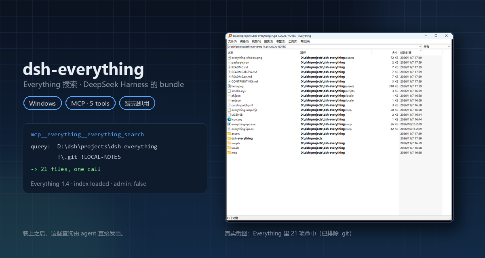

<div align="center">

[简体中文](README.md) · **English** · [繁體中文](README.zh-TW.md)

# dsh-everything

### Everything's filename index, wired into DeepSeek Harness as a bundle you install and forget.

**Find any file in milliseconds — no directory walking, no remembering which drive it lives on.**

[](https://github.com/cwen63970-coder/dsh-everything/actions/workflows/build.yml)
[](https://github.com/cwen63970-coder/dsh-everything/releases)
[](#requirements)
[](#requirements)
[](#what-it-does)
[](LICENSE)

[Install](#install) · [What it does](#what-it-does) · [How it works](#how-it-works) · [Query gotchas](#query-gotchas) · [Troubleshooting](#troubleshooting)

<code>plugin_manager install_bundle&nbsp;&nbsp;target=github:cwen63970-coder/dsh-everything</code>

</div>

> [!IMPORTANT]
> **Windows only.** Everything itself is a Windows application, and the IPC bridge is a small .NET binary.
> Everything must be installed and **running** — the index belongs to it; this plugin only queries.

<div align="center">
<br />

<br />
</div>

---

Everything keeps an index of every filename on every local volume. This bundle hands that index to the agent:
a query comes back in milliseconds, without walking a directory tree and without any cloud service.

Installing adds five tools named `mcp__everything__*` — the same names a hand-written MCP configuration would
produce. No profile edits, no restart, no first-run choices.

## Requirements

1. Windows 10/11.
2. Everything installed and running — it owns the index. Recommended settings under **Tools → Options → General**:
   - **Everything Service**: ticked (ticking it asks for elevation once, to install the service)
   - **Run on system startup**: ticked
   - **Run as administrator**: unticked

   That way the service indexes NTFS and Everything itself stays a standard-user process: it is ready right after
   boot, and programs launched from Everything do not inherit elevation. Running as administrator works too
   (verified), but then the service is not needed and everything you open from Everything runs elevated; Windows 10+
   also will not auto-start an elevated program, so leave it off if you want it at boot.
3. DSH `0.2.2-rc.1` or a later `0.2.x`.

## Install

```text
plugin_manager install_bundle   target=<npm spec> | github:<owner>/dsh-everything | link:<local path>
```

The bundle's patch inserts the MCP client row, computes the absolute path to its own server inside the profile,
and registers the tools. The loader hot-applies new entries, so it works immediately.

The manifest declares `dsh.bundle.platforms: ["win32"]`, so on Linux or macOS the host skips the whole bundle
instead of failing at spawn time.

## What it does

| Tool | Purpose |
|---|---|
| `everything_search` | Full Everything query syntax: name, path, size, date, wildcards, regex, `dupe:`, `empty:`, … |
| `everything_count` | Count matches without transferring rows |
| `everything_status` | Is Everything running / index loaded / elevated |
| `everything_recent` | Recently modified items (`dm:lastNdays`) |
| `everything_duplicates` | Names that occur more than once |

## How it works

```
DSH --(MCP stdio)-->  mcp/everything-mcp.mjs  --(line JSON)-->  mcp/everything-ipc.exe  --(WM_COPYDATA)-->  Everything.exe
```

Everything's command line has no "search and print results" switch, which is why the bridge exists: zero
dependencies, and it speaks Everything's own IPC protocol. Its source is `mcp/everything-ipc.cs`, which the
packaged `everything-ipc.exe` is compiled from; the same build also runs on GitHub Actions — every push
recompiles it from source on windows-latest and prints its SHA-256 in the log.

**No dependency on `node` being on PATH.** `command` is `process.execPath` — DeepSeek Harness itself, which is
Electron — with `env.ELECTRON_RUN_AS_NODE=1`. The host binary then behaves as a Node runtime (measured
`v24.21.0`), so the plugin works on machines without a standalone Node install.

## Query gotchas

**The full syntax is simply Everything's own search syntax.** The plugin hands `query` to Everything verbatim — it does not parse, whitelist or rewrite it, so anything you can type into Everything works here as well. These three bite most often:

| Query | Meaning |
|---|---|
| `dm:last7days` | The last seven days. A bare `dm:7days` is **not** that — it silently matches unrelated old files |
| `\node_modules` | Matches the full path, so it hits that whole subtree; `node_modules` only hits entries named that |
| `ext:exe` | Filter by extension. Type macros `exe:` / `doc:` / `pic:` are user-defined filters; undefined ones return zero silently |

`everything_search` and `everything_count` also take four switches each: `regex` (treat `query` as a regular
expression, in Everything's own dialect), `matchCase`, `wholeWord`, and `matchPath` (match the full path instead of
just the file name). They apply to that one call only and are independent of the same-named toggles in Everything's
GUI — with the GUI's regex mode on, plugin queries are still parsed as ordinary Everything syntax.

## Troubleshooting

| Symptom | Cause / fix |
|---|---|
| `Everything is not running` | Start Everything; it owns the index |
| A drive, USB disk or network location returns nothing | Everything indexes local NTFS volumes by default; add non-NTFS and network locations under Index → Folders |
| Tools missing entirely | Check `everything_status`; confirm the profile lists `dsh-everything` in `dsh.profile.bundles` |
| Empty results for a file you just created | Stale index, or the USN journal was not replayed at startup: check `ntfs_volume_load_recent_changes=1,1,1` in `%APPDATA%\Everything\Everything.ini` (`0,0,0` drops changes made while Everything was closed), or run `Everything.exe -reindex` |
| A query times out with `no reply` | Everything is still rebuilding its index (`index loaded: false` in `everything_status`); wait for it to finish |

## License

MIT. Not affiliated with or endorsed by [voidtools](https://www.voidtools.com/), the official home of Everything.
