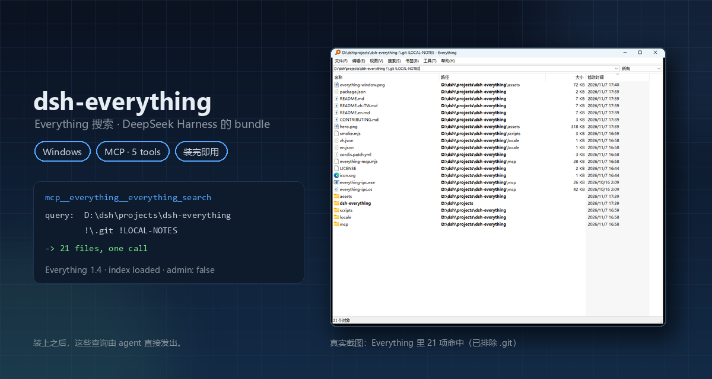

<div align="center">

[简体中文](README.md) · [English](README.en.md) · **繁體中文**

# dsh-everything-mcp

### 把 Everything 的檔案名稱索引接進 DeepSeek Harness 的唯讀檢索外掛。

**一次查詢定位已索引的檔案或資料夾——回傳路徑與中繼資料，不讀內容、不改檔案。**

[](https://github.com/cwen63970-coder/dsh-everything-mcp/actions/workflows/build.yml)
[](https://github.com/cwen63970-coder/dsh-everything-mcp/releases)
[](#執行前提)
[](#執行前提)
[](#它的作用)
[](LICENSE)

[安裝](#安裝) · [執行前提](#執行前提) · [它的作用](#它的作用) · [能力邊界](#能力邊界) · [運作原理](#運作原理) · [查詢語法](#查詢語法) · [疑難排解](#疑難排解)

<code>外掛 → 安裝第三方外掛：https://github.com/cwen63970-coder/dsh-everything-mcp</code>

</div>

> [!IMPORTANT]
> **僅限 Windows。** Everything 本身是 Windows 程式，IPC 橋梁也是一個小的 .NET 執行檔。
> Everything 必須已安裝且**正在執行**——索引歸它所有，此外掛只是查詢方。

<div align="center">
<br />

<br />
</div>

---

## 安裝

在 DSH 裡打開 **外掛 → 安裝第三方外掛**，在「新增外掛」的「套件名稱或位址」填入倉庫網址：

```text
https://github.com/cwen63970-coder/dsh-everything-mcp
```

也可以填簡寫 `github:cwen63970-coder/dsh-everything-mcp`（同一欄位也接受 npm 套件名稱與本機目錄），然後按「安裝」。
裝完後「已安裝外掛」裡會出現 `dsh-everything-mcp`，5 個 `mcp__everything__*` 工具立即可用——外掛的 patch 會自行
插入 mcp-client 設定、算出套件內伺服器的絕對路徑，不需要重新啟動。

> [!NOTE]
> 外掛在 manifest 裡宣告了 `dsh.bundle.platforms: ["win32"]`，Linux / macOS 上宿主會**整體略過**它，
> 而不是在 spawn 階段報錯。

習慣用指令的話，等價寫法是：

```text
plugin_manager install_bundle   target=github:cwen63970-coder/dsh-everything-mcp
```

## 執行前提

1. Windows 10/11；
2. Everything 已安裝且正在執行——索引歸它所有。

   還沒安裝的話，從官網下載安裝版：<https://www.voidtools.com/downloads/>（64 位元系統選檔名帶 `x64` 的
   那個，32 位元系統選不帶 `x64` 的），一路預設裝完即可。啟動後系統匣出現它的圖示就表示在執行，索引由它自己
   建立，能搜到檔案就算就緒——本外掛只是查詢方，不需要為它做任何設定。本外掛在 `Everything 1.4.1.1032` 上實測。

   建議在 **工具 → 選項 → 一般** 裡設成這樣：
   - **Everything 服務**：勾選（第一次勾選會要求一次系統管理員權限，用來安裝服務）
   - **隨系統自啟動**：勾選
   - **以系統管理員身分執行**：不勾選

   這樣由服務去索引 NTFS，Everything 本體保持一般權限：開機即可使用，從 Everything 裡開啟的程式也不會跟著提權。
   勾了最後一項也照樣能用（實測），只是那時不再需要服務，而從 Everything 開啟的程式都會提權；另外 Windows 10
   起不會自動啟動提權程式，想開機就用，就別勾它；

   **索引範圍也歸 Everything 管**：預設只索引本機 NTFS 固定磁碟區，隨身碟／行動硬碟／網路位置要在它裡面
   單獨加入（見[疑難排解](#疑難排解)）。
3. DSH `0.2.2-rc.1` 或更新的 `0.2.x`。

## 它的作用

給代理補上「檔案在哪」這一環：把 Everything 的本機索引包裝成 5 個 MCP 工具，讓模型依名稱、路徑、
副檔名、大小、日期或正規表示式，在**全部已索引的磁碟區**上一次查詢拿到候選路徑與中繼資料。

| 工具 | 用途 |
|---|---|
| `everything_search` | 完整 Everything 查詢語法：名稱、路徑、大小、日期、萬用字元、正規表示式、`dupe:`、`empty:` … |
| `everything_count` | 只統計命中數，不傳輸結果列 |
| `everything_status` | Everything 是否在執行 / 索引是否就緒 / 是否提權 |
| `everything_recent` | 最近修改的檔案（`dm:lastNdays`） |
| `everything_duplicates` | 重名檔案 |

對模型來說，這解決了原生手段的三個痛點：不用猜根目錄、逐層 `glob`；不用 `Get-ChildItem -Recurse`
掃碟（分鐘級，還會被權限打斷）；不用自己拼大小/日期/副檔名的組合篩選。工具名稱與手動設定 MCP 的寫法一致
（`mcp__everything__*`），不用改 profile。

## 它不做什麼

- **不讀檔案內容**——只回傳路徑、大小、時間等中繼資料；要看內容請用 `read` / `grep`。
- **不寫檔案、不改 Everything 設定**——所有呼叫都是唯讀查詢。
- **不維護自己的索引**——索引歸 Everything，外掛只是查詢方。
- **不能證明「檔案不存在」**——空結果只說明「目前索引裡沒有」。索引範圍外、索引重建中、未監控的磁碟區
  都會造成假陰性；`everything_status` 會回報 `index busy`。

## 能力邊界

| 維度 | 實際情況 |
|---|---|
| 覆蓋範圍 | 僅 Everything 已索引的內容。預設是本機 NTFS 固定磁碟區；FAT/exFAT、可移動磁碟、網路位置需在 Everything 裡單獨加入 |
| 結果完整性 | 依賴索引狀態。`everything_status` 顯示 `index busy` 時結果可能大幅缺失（實測同一路徑 66 筆 vs 6,769 筆） |
| 速度 | 一般按名查詢毫秒級；按大小/日期排序、`max` 很大、或 `duplicates` 掃描數萬列時會到秒級 |
| 資料流向 | 檢索在本機完成，不經過第三方搜尋服務；但**回傳的路徑與中繼資料會進入對話上下文** |
| 平台 | 僅 Windows；Everything 必須已安裝並正在執行 |

## 運作原理

```
DSH --(MCP stdio)-->  mcp/everything-mcp.mjs  --(逐行 JSON)-->  mcp/everything-ipc.exe  --(WM_COPYDATA)-->  Everything.exe
```

Everything 內建的命令列沒有「搜尋並輸出結果」的開關，所以必須有這座橋梁：它零相依，直接實作 Everything 的
IPC 協定。原始碼在 `mcp/everything-ipc.cs`，套件裡的 `everything-ipc.exe` 就是它編譯出來的；同樣的編譯也在
GitHub Actions 上跑——每次推送都會在 windows-latest 上從原始碼重新編譯一份，並在日誌裡印出它的 SHA-256。

**不依賴 PATH 裡的 `node`。** `command` 使用 `process.execPath`（DeepSeek Harness 本身，即 Electron）搭配
`env.ELECTRON_RUN_AS_NODE=1`，宿主執行檔隨即以 Node 執行環境運作（實測 `v24.21.0`），因此沒安裝獨立
Node 的機器也能使用。

## 查詢語法

**完整語法就是 Everything 自己的搜尋語法。** 外掛把 `query` 原樣交給 Everything 解析——不解析、不白名單、不改寫，所以能在 Everything 裡寫的任何寫法都能直接寫進 `query`。下面三條是最容易踩到的：

| 寫法 | 含義 |
|---|---|
| `dm:last7days` | 最近 7 天。直接寫 `dm:7days` **不是**這個意思，會默默比對到無關的舊檔案 |
| `\node_modules` | 比對完整路徑，命中該目錄子樹；`node_modules` 只命中名稱真的是這個的項目 |
| `ext:exe` | 依副檔名篩選。類型巨集 `exe:` / `doc:` / `pic:` 是使用者自訂的篩選器，未定義時默默回傳 0 筆 |

`everything_search` 與 `everything_count` 還各帶四個開關：`regex`（把 `query` 當成正規表示式）、`matchCase`、`wholeWord`、`matchPath`（比對完整路徑，而不是只比對檔名）。它們只作用於這一次呼叫，與 Everything GUI 裡同名的勾選框互不影響——GUI 的正規表示式開關打開時，外掛查詢仍以一般語法解析。

## 疑難排解

| 現象 | 原因 / 處理 |
|---|---|
| `Everything is not running` | 啟動 Everything；索引歸它所有 |
| 某個磁碟、隨身碟或網路位置搜不到 | 都在 **工具 → 選項** 裡改。預設只索引本機 NTFS 固定磁碟區：NTFS 格式的隨身碟／行動硬碟 →「索引 → NTFS」勾「自動包含新增的可移動卷」；FAT 格式（exFAT / FAT32）→「索引 → 資料夾」把磁碟機代號加進去（Everything 1.5 則在「索引 → FAT」勾同樣的選項）；網路位置 → 同樣走「索引 → 資料夾」 |
| 工具完全不出現 | 先看 `everything_status`；再確認「外掛 → 已安裝外掛」裡有 `dsh-everything-mcp` |
| 剛建立的檔案搜不到 | 先確認該磁碟區在索引裡、且勾了「監控變更」（非 NTFS 與網路位置要單獨加入）；Everything 正在重建索引時也查不到，等 `index loaded: true`；仍不行則執行 `Everything.exe -reindex` |
| 查詢逾時、回報 `no reply` | Everything 正在重建索引，還沒載入完成（`everything_status` 裡 `index loaded: false`）；等它載入完再查 |

## 授權條款

MIT。與 [voidtools](https://www.voidtools.com/)（Everything 的官方網站）無隸屬或背書關係。
